# THREATNEX
### AI-Powered Cyber Threat Intelligence and Investigation Platform

[](https://fastapi.tiangolo.com)
[](https://www.python.org/)
[](https://react.dev/)
[](https://www.typescriptlang.org/)
[](https://tailwindcss.com/)
[](https://www.postgresql.org/)
[](https://redis.io/)
[](https://www.docker.com/)
[](docs/SECURITY.md)
[](docs/PROJECT_STATUS.md)

THREATNEX is a production-grade, enterprise Security Operations Center (SOC) and Cyber Threat Intelligence (CTI) platform. Engineered for threat analysts, incident response teams, and security engineers, THREATNEX combines multi-source external threat intelligence ingestion, automated indicator correlation, incident case management, and generative AI reasoning powered by Google Gemini to accelerate triage from alert detection to containment.

---

## Key Features & Capabilities

```
+---------------------------------------------------------------------------------+
|                              CORE CAPABILITIES                                  |
+---------------------------------------------------------------------------------+

  OPERATIONS                  INTELLIGENCE                 GOVERNANCE & TRIAGE
  • SOC Telemetry Dashboard   • Multi-Provider IOC Engine  • Security Alert Queue
  • Incident Case Management  • Real-Time Threat Feed      • 24h Noise Deduplication
  • Observable Correlation    • Gemini AI Threat Analyst   • Threat Watchlists
  • Evidence Timeline         • MITRE ATT&CK Mapping       • Markdown / JSON Reports
  • Role-Based Access Control • Provider Health Monitoring • Compliance Audit Trail
```

### 1. Multi-Provider IOC Investigation Engine
- Simultaneous enrichment across **VirusTotal**, **AbuseIPDB**, **AlienVault OTX**, and **URLhaus**.
- Semantic auto-detection and validation for **IPv4**, **IPv6**, **Domain**, **URL**, **MD5**, **SHA1**, **SHA256**, and **CVE**.
- Composite risk scoring computed as a normalized weighted matrix configured via administrative policy.
- Zero client-side API key exposure; all provider queries originate strictly from the backend container network.

### 2. Real-Time Threat Intelligence Feed
- Ingests, normalizes, and deduplicates high-confidence indicators from **CISA Known Exploited Vulnerabilities (KEV)**, **URLhaus payload feeds**, **AlienVault OTX pulses**, **AbuseIPDB**, and **VirusTotal**.
- Dynamic search and multi-facet filtering by severity (`critical`, `high`, `medium`, `low`), provider, and threat classification.
- One-click investigation pivot directly from any feed item into full IOC telemetry.

### 3. AI Cyber Threat Analyst (Google Gemini)
- Automated threat reasoning synthesizing multi-source provider evidence into structured intelligence.
- Maps corroborated indicator observations to standard **MITRE ATT&CK tactics and techniques**.
- Strictly distinguishes verified observable evidence from probabilistic AI reasoning hypotheses.
- Generates actionable containment actions and investigation playbooks with complete historical persistence.

### 4. Targeted Threat Watchlists
- High-priority indicator tracking for VIP assets, critical infrastructure endpoints, and active APT campaigns.
- Complete observable lifecycle tracking (severity, confidence, expiration timestamps, and retirement).
- Real-time match detection telemetry tracking hits across platform investigations.

### 5. Security Alerts & Noise Suppression
- Automated alert ingestion from incoming telemetry and manual analyst escalations.
- Intelligent **24-hour deduplication window** to eliminate alert fatigue and suppress duplicate events.
- Structured triage lifecycle (`open` → `acknowledged` → `resolved` / `escalated`).
- Mandatory operator resolution notes and one-click escalation into formal investigation cases.

### 6. Incident Case Management
- End-to-end incident response case tracking with priority triage (`critical`, `high`, `medium`, `low`).
- Multi-tenant tenant isolation: non-admin analysts access only assigned, owned, or unassigned cases.
- Observable association, case notes, and cryptographic audit log attribution.

### 7. Intelligence Reporting Engine
- Generates formal Incident Post-Mortems, Technical IOC Briefings, and Executive Summaries.
- Dual-format export: formatted **Markdown (`.md`)** and machine-readable **JSON**.
- In-browser interactive preview drawer with clipboard copying and direct file download.

### 8. SOC Compliance Audit Trail
- Immutable, tamper-evident audit trail capturing all user authentication attempts, indicator queries, case updates, and administrative modifications.
- Filterable by action type, resource domain, actor, and client IP address with full pagination.
- Designed to satisfy SOC 2 Type II and ISO 27001 statutory audit requirements.

### 9. SOC Policies & Dynamic Risk Scoring
- Configurable multi-engine threat calculation weights (VirusTotal, AbuseIPDB, AlienVault OTX, URLhaus).
- Automated alert confidence thresholds and auto-escalation triggers.
- Safe provider connectivity status indicators with zero secret exposure.

---

## Application Interface Preview

| SOC Operational Dashboard | Multi-Provider IOC Investigation |
| :---: | :---: |
| 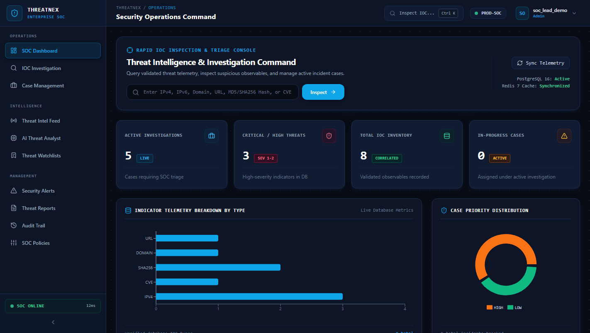 | 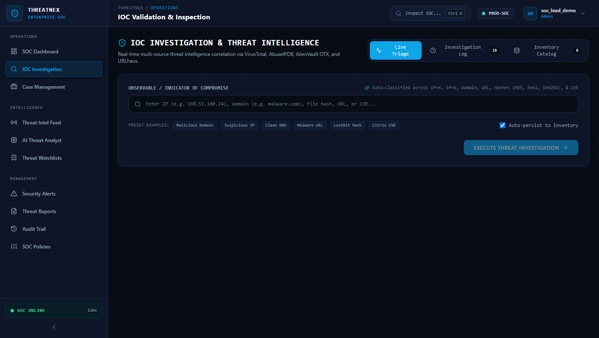 |

| Real-Time Threat Intelligence Feed | AI Cyber Threat Analyst (Gemini) |
| :---: | :---: |
| 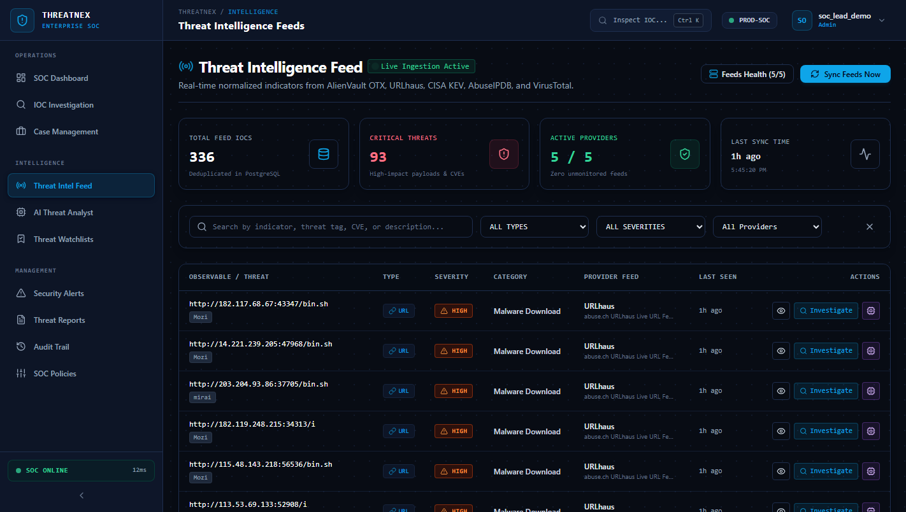 | 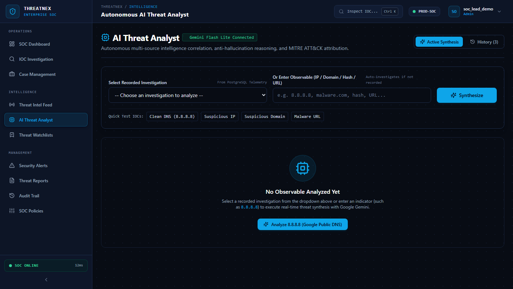 |

| Targeted Threat Watchlists | Security Alert Triage Queue |
| :---: | :---: |
| 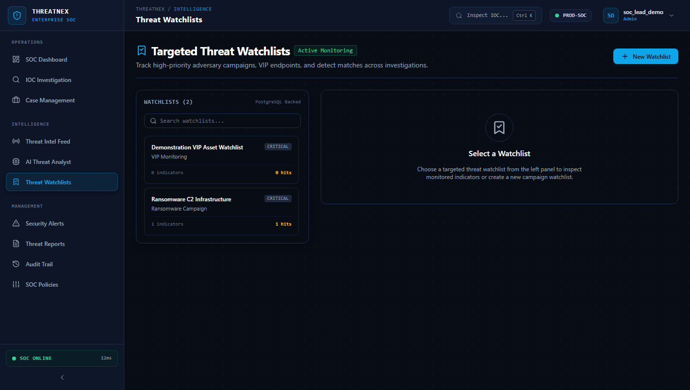 | 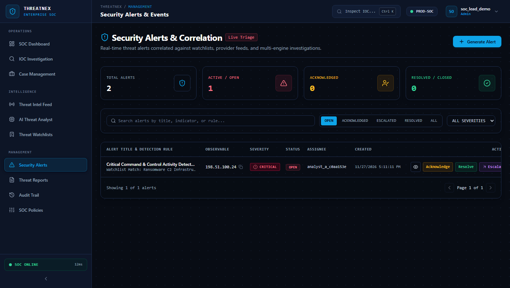 |

| Incident Case Management | Threat Intelligence Reports |
| :---: | :---: |
| 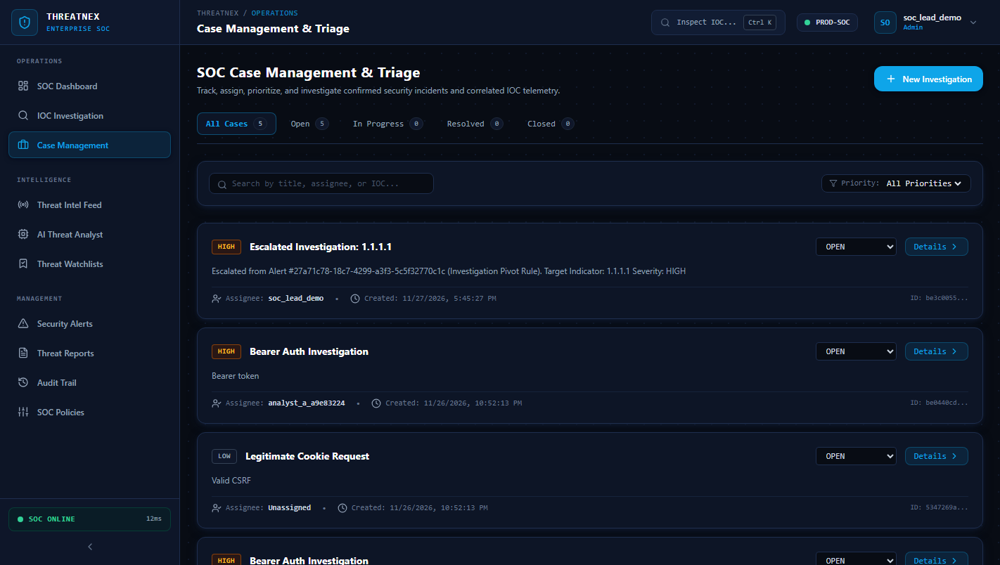 | 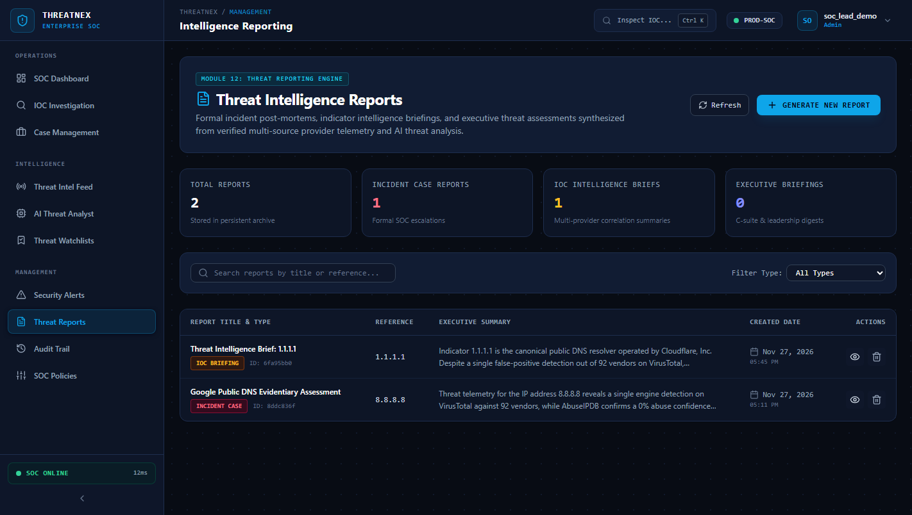 |

| Compliance Audit Trail | SOC Policies & Risk Matrix |
| :---: | :---: |
| 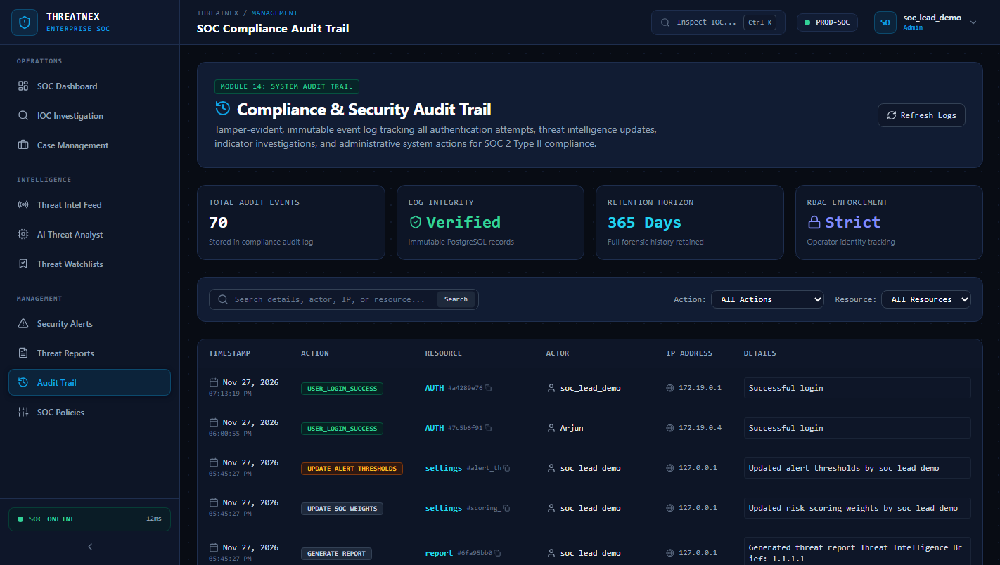 | 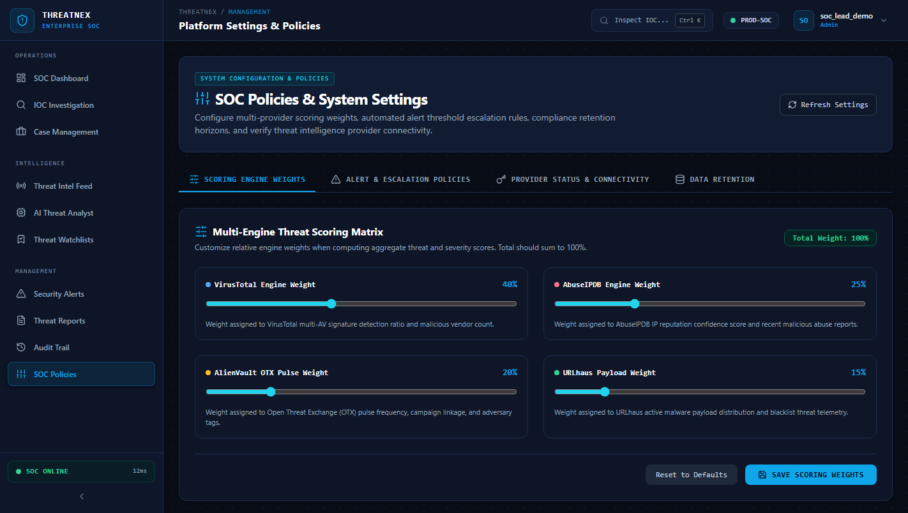 |

---

## Architecture Overview

THREATNEX is engineered as a **Modular Monolith** deployed within an isolated Docker bridge network:

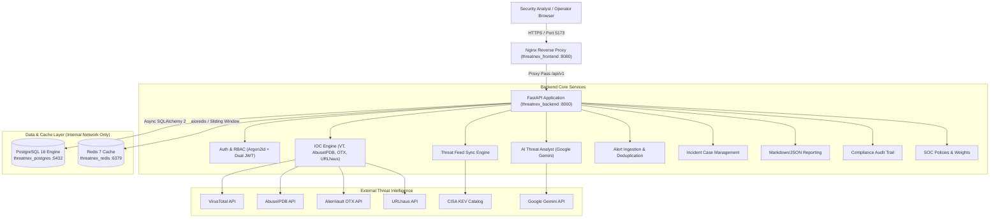

---

## Technology Stack

| Layer | Technologies | Rationale |
| :--- | :--- | :--- |
| **Backend Framework** | **FastAPI (Python 3.12)** | Asynchronous high-performance REST engine with Pydantic v2 data validation and automatic OpenAPI generation. |
| **Database** | **PostgreSQL 16** | ACID-compliant relational storage with JSONB support, managed via asynchronous **SQLAlchemy 2** and **Alembic** migrations. |
| **Caching & Rate Limiting** | **Redis 7** | Distributed sliding-window rate limiting, token revocation blacklists, and high-speed telemetry caching. |
| **Frontend Framework** | **React 18 + Vite** | Single-page application architecture with strict TypeScript compilation and component-level state isolation. |
| **Styling & Theme** | **Tailwind CSS** | Custom enterprise SOC dark palette (`slate-950`, `cyan-400`, `rose-400`, `emerald-400`) engineered for 24/7 operations centers. |
| **State & Data Fetching** | **TanStack React Query v5** | Server-state caching, background revalidation, and optimistic mutation handling. |
| **Containerization** | **Docker & Docker Compose** | Multi-container microsegmentation with read-only root filesystems, dropped Linux capabilities, and non-root execution. |

---

## Quickstart & Docker Deployment

### Prerequisites
- **Docker Desktop** (version 24.0+) or **Docker Engine** with Docker Compose v2.
- **Git** (version 2.40+)

### 1. Clone the Repository
```bash
git clone https://github.com/Arjun187187/THREATNEX.git
cd THREATNEX
```

### 2. Configure Environment Variables
Copy the template configuration file:
```bash
cp .env.example .env
```
*(Optional)* Add your third-party API keys (VirusTotal, AbuseIPDB, AlienVault OTX, URLhaus, Gemini) into `.env`. If omitted, providers gracefully fall back to unrestricted public endpoints.

### 3. Launch the Platform
```bash
docker compose up -d --build
```

### 4. Verify Services
```bash
docker compose ps
```
All four services will report `healthy`:
```
NAME                 IMAGE                   STATUS                   PORTS
threatnex_postgres   postgres:16-alpine      Up (healthy)             5432/tcp
threatnex_redis      redis:7-alpine          Up (healthy)             6379/tcp
threatnex_backend    cyberproject-backend    Up (healthy)             127.0.0.1:8001->8000/tcp
threatnex_frontend   cyberproject-frontend   Up (healthy)             127.0.0.1:5173->8080/tcp
```

### 5. Access the Platform
- **SOC Web Dashboard:** [http://localhost:5173](http://localhost:5173)
- **Interactive OpenAPI Docs:** [http://localhost:8001/docs](http://localhost:8001/docs)
- **Health Probe:** [http://localhost:8001/health](http://localhost:8001/health)

---

## Automated Verification & Test Results

The platform includes a comprehensive automated test suite and an end-to-end user workflow verification runner.

### Backend Automated Test Suite
```bash
# Run pytest test suite:
docker exec threatnex_backend pytest -v tests/
```
```
tests/test_auth.py::test_user_registration_and_login .................. PASSED
tests/test_auth.py::test_duplicate_user_registration_fails ............ PASSED
tests/test_health.py::test_health_check ............................... PASSED
tests/test_indicators.py::test_ipv4_validation ........................ PASSED
tests/test_indicators.py::test_ipv6_validation ........................ PASSED
tests/test_indicators.py::test_hashes_validation ...................... PASSED
tests/test_indicators.py::test_cve_validation ......................... PASSED
tests/test_indicators.py::test_domain_and_url_validation ............. PASSED
tests/test_indicators.py::test_ioc_api_validation_authenticated ...... PASSED
tests/test_investigations.py::test_investigation_lifecycle ............ PASSED
tests/test_security.py::test_idor_investigations_list_and_detail ...... PASSED
tests/test_security.py::test_refresh_token_rotation_and_reuse ......... PASSED
tests/test_security.py::test_httponly_cookie_authentication .......... PASSED
tests/test_security.py::test_production_rejects_weak_secret ........... PASSED
tests/test_security.py::test_proxy_ip_spoofing_defense ................ PASSED
tests/test_security.py::test_csrf_cookie_mutating_requests ............ PASSED
tests/test_security.py::test_concurrent_refresh_rotation .............. PASSED
tests/test_security.py::test_production_redis_fail_closed ............. PASSED
tests/test_security.py::test_proxy_ip_spoofing_defense_right_to_left .. PASSED

======================= 19 passed in 7.19s (100% Pass Rate) =======================
```

### End-to-End Workflow Verification
Execute all 11 user workflows end-to-end:
```bash
python scripts/verify_e2e_workflows.py
```
```
[PASS] Workflow 1: Operator authenticated and session verified.
[PASS] Workflow 2: Real indicator investigated across configured providers.
[PASS] Workflow 3: Threat feed pagination, severity filtering, and manual sync verified.
[PASS] Workflow 4: Opened indicator from feed into live IOC investigation.
[PASS] Workflow 5: Real Gemini AI analysis executed and saved to history.
[PASS] Workflow 6: Watchlist created, indicator added and removed.
[PASS] Workflow 7: Generated security alert from investigation.
[PASS] Workflow 8: Complete alert triage lifecycle verified (ack, resolve, escalate).
[PASS] Workflow 9: Threat Report generated and retrieved.
[PASS] Workflow 10: Audit trail viewing, search and filtering verified.
[PASS] Workflow 11: SOC scoring weights and alert thresholds updated successfully.

======================================================
SUCCESS: ALL 11 END-TO-END DEMONSTRATION WORKFLOWS PASSED!
======================================================
```

---

## Security Architecture Summary

THREATNEX enforces strict defense-in-depth across every platform tier:

1. **Authentication & Session Lifecycle:**
   - Passwords hashed with **Argon2id** (64MB memory, 3 iterations).
   - Dual JWT architecture with 30-minute access tokens and 7-day refresh tokens.
   - Refresh token family rotation with automatic replay attack detection.
   - Distributed token revocation blacklists stored in Redis with automated TTLs.
2. **CSRF & Origin Protections:**
   - Session cookies delivered as `HttpOnly`, `SameSite=Lax`, and `Secure`.
   - Mutating requests authenticated via cookies require custom `X-Requested-With: XMLHttpRequest` header.
   - Strict origin validation against allowed `BACKEND_CORS_ORIGINS`.
3. **Fail-Closed Security Policy:**
   - In production mode, if Redis is unavailable, token revocation and rate limiting immediately fail closed (HTTP 503) to prevent split-brain state.
4. **Container & Microsegmentation:**
   - Microservices execute under dedicated non-root service accounts (`threatnex`, `nginx`).
   - Read-only root filesystems (`read_only: true`) and dropped Linux capabilities (`cap_drop: ALL`).
   - PostgreSQL and Redis isolated exclusively to internal Docker networks with zero public host port exposure.

*For complete threat models, remediation records, and verification checklists, see [docs/SECURITY.md](docs/SECURITY.md).*

---

## Project Structure

```
THREATNEX/
├── backend/
│   ├── alembic/                      # Database schema migrations (001 - 006)
│   ├── app/
│   │   ├── core/                     # Configuration, database session, Argon2id, RBAC, Redis
│   │   ├── common/                   # Base mixins, models, and shared utilities
│   │   └── modules/
│   │       ├── auth/                 # Operator authentication, tokens, cookie management
│   │       ├── indicators/           # IOC enrichment engine (VT, AbuseIPDB, OTX, URLhaus)
│   │       ├── threat_intel/         # Real-time threat feed collection & synchronization
│   │       ├── ai_analyst/           # Google Gemini threat reasoning & MITRE mapping
│   │       ├── watchlists/           # Targeted threat watchlist monitoring engine
│   │       ├── alerts/               # Alert ingestion, 24h deduplication, and triage
│   │       ├── investigations/       # Incident case management & observable linkage
│   │       ├── reports/              # Markdown and JSON report generation
│   │       ├── audit/                # Immutable compliance audit trail
│   │       ├── settings/             # Dynamic scoring weights & alert policies
│   │       └── dashboard/            # Real-time SOC metrics and telemetry
│   ├── tests/                        # Automated Pytest test suite (19 test cases)
│   ├── Dockerfile                    # Multi-stage hardened backend container
│   └── requirements.txt              # Production Python dependencies
├── frontend/
│   ├── src/
│   │   ├── api/                      # Axios client with automatic token refresh interceptors
│   │   ├── components/               # SOC dark UI components, badges, layout, navigation
│   │   ├── context/                  # AuthContext operator session state
│   │   ├── pages/                    # 11 production SOC pages
│   │   └── types/                    # TypeScript interfaces and domain schemas
│   ├── nginx.conf                    # Hardened unprivileged Nginx reverse proxy config
│   ├── Dockerfile                    # Multi-stage production frontend container
│   ├── package.json                  # Frontend dependencies
│   └── vite.config.ts                # Vite bundler configuration
├── docs/
│   ├── architecture/                 # Architecture notes and diagrams
│   ├── screenshots/                  # Verified application interface captures
│   ├── API.md                        # Complete REST API endpoint reference
│   ├── ARCHITECTURE.md               # Detailed system design specification
│   ├── INSTALLATION.md               # Deployment and local installation guide
│   ├── PROJECT_STATUS.md             # Operational status and test verification matrix
│   ├── ROADMAP.md                    # Strategic product roadmap and future milestones
│   └── SECURITY.md                   # Enterprise security architecture specification
├── scripts/
│   ├── verify_e2e_workflows.py       # Automated 11-step end-to-end verification runner
│   └── README.md                     # Script usage and execution instructions
├── .env.example                      # Sanitized environment configuration template
├── .gitignore                        # Git exclusion rules
├── docker-compose.yml                # Hardened 4-service microsegmentation orchestration
└── README.md                         # Main repository documentation entrypoint
```

---

## Documentation Directory Index

- [Architecture & Design Specification](docs/ARCHITECTURE.md)
- [REST API Reference](docs/API.md)
- [Enterprise Security Specification](docs/SECURITY.md)
- [Installation & Deployment Guide](docs/INSTALLATION.md)
- [Operational Status & Verification](docs/PROJECT_STATUS.md)
- [Product Roadmap & Milestones](docs/ROADMAP.md)

---

## License

This software is maintained by Arjun C S for demonstration and portfolio presentation. All rights reserved.
